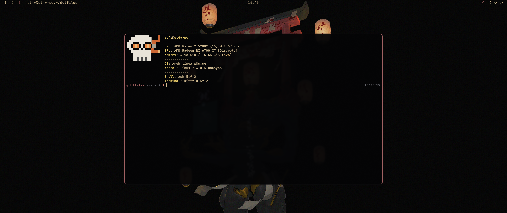

<h1 align="center">dotfiles</h1>

<p align="center">
  Arch Linux + Hyprland (Wayland), themed from one place with
  <a href="https://github.com/bjarneo/aether">Aether</a>.
</p>

<p align="center">
  
</p>

## Highlights

- **One source of colors.** Pick a theme in Aether and the bar, launcher,
  notifications, terminal, window borders, lock screen, editor, file manager,
  GTK and Qt apps, browser, Discord, wallpaper and login screen all follow.
  Nothing hardcodes a color.
- **Waybar with a utilities drawer.** Always-visible status (battery, audio,
  mic, power) on the right; click the handle to slide out tray, keyboard
  layout, network, brightness, notifications and weather. Lucide icons
  throughout.
- **Calendar tooltip you can drive from the keyboard.** Hover the clock and use
  the arrow keys to change month, Backspace to return to today.
- **Notification center on top of mako.** Starts in do-not-disturb, collects
  everything, and the bell shows the history. Click toggles do-not-disturb,
  right-click clears.
- **Wofi menus** for audio, network, power and TLP profiles.
- **Two machines, one repo.** The desktop and the laptop share everything;
  per-machine values sit behind a hostname check in `hypr/hyprland.lua`.
- **Themed login screen.** The SDDM theme takes its colors and a pre-blurred
  wallpaper from the current Aether theme.

## Structure

| Path | What it is |
|---|---|
| `aether/` | Templates and hooks that let Aether color waybar, wofi, mako, kitty, Hyprland borders, hyprlock, Zed, Dolphin, GTK apps (including file pickers), Zen and Vesktop |
| `hypr/` | Hyprland (`hyprland.lua`, `hypridle.conf`, `hyprlock.conf`) |
| `waybar/` | Status bar: modules, styles and the scripts behind the custom modules |
| `wofi/` | App launcher and the audio, network, power and TLP menus |
| `kitty/` | Terminal |
| `zed/` | Editor |
| `zsh/` | `.zshrc`, `.p10k.zsh` |
| `fastfetch/` | System info config and ASCII logo |
| `zen/chrome/` | Zen browser `userChrome` / `userContent` |
| `qt6ct/` | Template for the Qt style (Fusion) and font; Aether's hook fills in the icon theme and palette |
| `fonts/` | Lucide icon font used by waybar's icons |
| `fontconfig/` | Default font substitution (JetBrainsMono Nerd Font) |
| `sddm/` | Login screen theme |
| `tlp/` | TLP power settings for the laptop |

## How theming works

Aether is the only source of colors, the wallpaper and the icon variant. Pick or
generate a theme in the Aether app and everything below follows: waybar, wofi,
mako, kitty, Hyprland borders, hyprlock, Zed, Dolphin and Qt apps, GTK apps and
file pickers, Zen, Vesktop, the wallpaper (hyprpaper) and the SDDM login screen.
Each app has a template in `aether/custom/` and, where needed, a hook that
reloads it. Your saved themes live in `~/.config/aether/` (not in this repo);
copy `~/.config/aether/blueprints/` to bring them to another machine.

## Setup

On a new machine, in this order:

1. **Older setup?** If the machine had the Kvantum/Breeze-based setup, clean it
   up first (see [Moving from an older setup](#moving-from-an-older-setup)).
2. **Clone:** `git clone <this-repo> ~/dotfiles`
3. **Install packages:** the [Prerequisites](#prerequisites) below.
4. **Link configs:** `~/dotfiles/install.sh`. It symlinks every config into
   place, is safe to re-run, and backs up any pre-existing real config
   instead of overwriting it.
5. **Login screen** (needs sudo once): `~/dotfiles/sddm/setup.sh`. It installs the
   theme into a directory you own, so every Aether apply updates the login
   screen's colors and background.
6. **Aether:** copy your saved themes to `~/.config/aether/blueprints/` if you
   have them, open Aether, enable the `kitty`, `hyprlock` and `vencord` apps
   and disable the built-in `hyprland` and `mako` apps (`aether/custom/` replaces
   them), then apply a theme. `install.sh` never picks one, so it can't
   overwrite yours.
7. **Vesktop:** Settings → Themes → enable `aether.theme.css` (Discord needs
   internet to load the theme's base stylesheet).
8. **Log out and back in.** The Qt and GTK environment variables are read at
   session start.

## Prerequisites

```
sudo pacman -S hyprland xdg-desktop-portal-hyprland xdg-desktop-portal-gtk hyprpolkitagent \
  hypridle hyprlock hyprpaper mako grim slurp wl-clipboard brightnessctl \
  waybar kitty wofi zed zsh fastfetch dolphin \
  playerctl wireplumber pipewire pipewire-pulse pipewire-alsa pipewire-jack pipewire-audio \
  qt6ct qt5-wayland qt6-wayland \
  ttf-jetbrains-mono-nerd papirus-icon-theme python-pillow libnotify networkmanager dbus
```

AUR (via `yay`/`paru`):

```
yay -S zen-browser-bin zsh-theme-powerlevel10k-git aether yaru-icon-theme
```

## Moving from an older setup

If the machine had the earlier Kvantum/Breeze-based setup, remove what would
fight this one, then run `install.sh` (it backs up anything it would overwrite
as `.bak`):

```
sudo pacman -Rns kvantum kvantum-qt5 mpvpaper nwg-look
```

Also remove `plasma-integration`, `kde-gtk-config` and `breeze-gtk` if present,
and delete the leftovers:

- `~/.config/Kvantum/`
- `~/.config/qt6ct/colors/Dwarven.conf` and `~/.config/qt6ct/style-colors.conf`
- `~/.local/share/color-schemes/Dwarven.colors`
- Old Breeze files in `~/.config/gtk-3.0/` and `~/.config/gtk-4.0/`
  (`colors.css`, `window_decorations.css`, `assets/`, `settings.ini`)
- Broken symlinks left by the pull: `~/.config/gtk-3.0/gtk.css`,
  `~/.config/qt6ct/qt6ct.conf`

Keep `qt6ct`, `papirus-icon-theme`, `adwaita-icon-theme` and `breeze-icons`
(a Dolphin dependency).

Notes:
- GTK apps use Adwaita's dark variant (`GTK_THEME` in `hypr/hyprland.lua`, also
  handed to the GTK portal at startup so file pickers come up dark); the
  colors come from `aether/custom/gtk3` and `gtk4`.
- Qt apps get their icon theme and palette from the Aether hooks, so
  `qt6ct/qt6ct.conf` is a template and isn't linked by `install.sh`.
